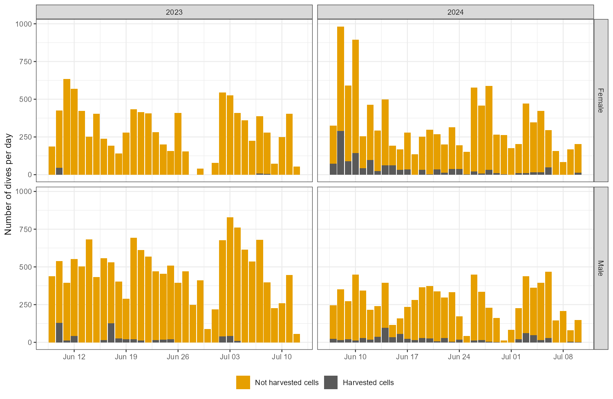
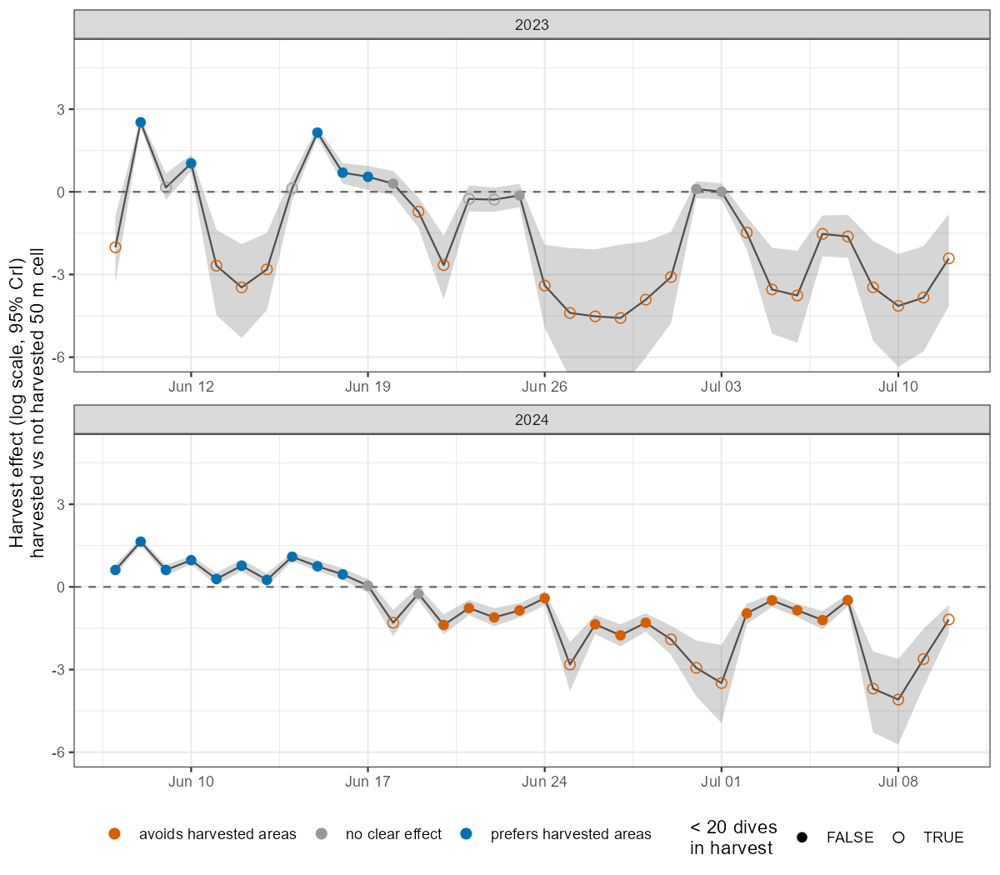
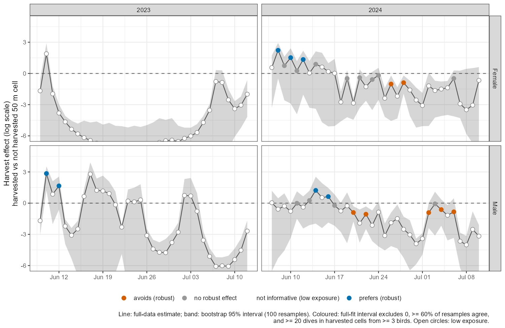

# Introduction

Kelp forests around the Sklinna colony are harvested commercially, and European shags (*Gulosus aristotelis*) feed in the same kelp. The question addressed here is whether, within the area the birds can reach, shags **use recently harvested kelp less (avoid) or more (prefer) than expected from the habitat that is available**.

GPS-tracked dive locations are presence-only data: they show where birds were, not where they could have been. Methods that compare dives with randomly generated "available" points can depend on how those points are generated [@renner2015point]. We therefore model the dive locations directly as a **log-Gaussian Cox process (LGCP)** [@illian2008statistical; @gomez2020bayesian], fitted with INLA [@rue2009approximate; @inla] through the inlabru package [@inlabru]. In an LGCP the expected number of dives per unit area, the intensity $\lambda(x)$, varies over space, and the log intensity is a linear combination of covariates plus an optional spatial random field:

$$\log \lambda(x) = \beta_0 + \sum_k \beta_k z_k(x) + w(x).$$

The likelihood compares the intensity at the observed dives with its integral over the whole study region, so the "available" habitat enters through the integration points and no pseudo-absences are needed. Further background is given in @blangiardo2015spatial.

Three models have been implemented. They share the same data, habitat covariates and study region (section 2) but differ in how harvest timing is represented:

| Model | Harvest covariate | Time | Sexes | Question |
|---|---|---|---|---|
| 1. Period model | Harvested before the start of each period | Three periods (before, during, after the June harvest) | Separate models | Was use of harvested cells different in each period? |
| 2. Space-time model | Harvested before the dive (daily, exact) | 68 daily slices | Pooled, sex random intercept | On which days did the harvest effect differ from zero? |
| 3. Sex-specific space-time model with bird bootstrap | Harvested before the dive (daily, exact) | 68 daily slices | Separate daily trend for each sex | Which days show a response that survives re-sampling of birds? |

Model 3 is the one used for the harvest conclusions; Models 1 and 2 document how the analysis was built up and provide a consistency check.

# Data and common model components

## Study region and dives

The study region is the area within 35 km of the colony (the approximate foraging range), restricted to water. Water was defined from the GEBCO elevation (below 0 m) or any kelp in the cell; GEBCO has a resolution of about 450 m, so a few dives fall on "land" cells and those without kelp were dropped. All dive locations are used, inside and outside kelp, with duplicated coordinates within a bird removed. Dives were GPS-tracked in June and July of 2023 and 2024. The model covers every day with data.

## Number of dives in harvested and not harvested cells

To show how much data underlies the harvest comparison, @tbl-recon reconciles the raw dive records with the dives used in the models, @tbl-totals gives totals per year and sex, and @fig-dives shows the number of dives per day split by whether the dive fell in a harvested 50 m cell (harvest status at the exact time of the dive, using the definition below). The daily counts are also saved as a table (`vignettes/inla_st70/dives_per_day_harvested.csv`). The only dives removed are duplicated coordinates within a bird and dives on non-water cells; **no thinning to reduce spatial autocorrelation is applied in the INLA models**.

```{r dives-recon}
#| label: tbl-recon
#| tbl-cap: "From raw dive records to the dives used in the INLA models."
knitr::kable(read.csv("inla_st70/dives_reconciliation.csv"), format.args = list(big.mark = ","))
```

```{r dives-totals}
#| label: tbl-totals
#| tbl-cap: "Dives per year and sex in harvested and not harvested cells (all days)."
tt <- read.csv("inla_st70/dives_totals_harvested.csv")
tt$Year <- as.character(tt$Year)
names(tt) <- c("Year", "Sex", "Days", "Birds", "Dives", "In harvested cells", "In not harvested cells", "% in harvested")
knitr::kable(tt, format.args = list(big.mark = ","))
```

{#fig-dives}

Harvested cells hold a small share of all dives: under 1% for females in 2023, about 3% for males in 2023, and 11% and 8% for females and males in 2024. The shortage of dives in harvested cells in 2023 is the reason the 2023 harvest effect cannot be estimated.

## Habitat covariates

All covariates are read from the same 50 m raster for dives and for integration points, so that dives and the available habitat are described identically:

- **Kelp presence:** 1 if the 50 m cell contains any kelp, 0 otherwise.
- **Depth and depth squared:** log depth (from GEBCO), standardised, with a quadratic term to allow a preferred depth.
- **Distance to the colony:** log distance, standardised (Model 1) or modelled with a smooth spline, a second-order random walk over 25 distance bins (Models 2 and 3).

## Harvest covariate

Harvest records have a time stamp (`GIS_TIME`). A location is "harvested" if it lies within 50 m of a harvest polygon. The models differ in which cuts count:

- **Model 1:** all cuts of the same calendar year made before the start of the period, using one raster per period.
- **Models 2 and 3:** the covariate is binary and varies in time. A point observed at time $s$ in year $Y$ has harvest = 1 if it lies within 50 m of a cut made from 1 September of year $Y-1$ up to and including time $s$, and 0 otherwise. This is computed from a *first-cut raster* (a 50 m cell stores the earliest cut time in the window), because the value on any day is simply whether the first cut was on or before that time. Dives use their exact time stamp and integration points use noon of the day. This reproduces, at every location, the definition of the point-level `harvested50m` flag.

A cell cut several times is treated like a cell cut once, in all three models.

## Mesh and spatial field

The spatial field $w(x)$ is a Matérn field approximated on a triangular mesh (the SPDE approach). Models 2 and 3 use a mesh built with `create_fmesher_mesh_from_locations()`, in which **the dive locations are the mesh nodes**, the 35 km study region is the boundary and the outer triangles are coarse (1,117 nodes). Using the kelp-region outline as boundary left only 59% of the integration points inside the mesh and caused INLA to fail, so the full study region is used. Model 1 is fitted with a spatial field on a regular mesh over the study region.

## Integration points and effort

The LGCP integral is approximated by a set of integration points with weights equal to the area they represent. Model 1 uses a regular 50 m grid of all water cells. Models 2 and 3 use a coarse 400 m grid of never-harvested cells (harvest = 0 at all times) plus a random sample of the ever-harvested cells replicated for each day and sex, with weights multiplied by **effort**: the number of birds with at least one dive on that day and sex. This accounts for the number of tracked birds changing over the season.

# Model 1: period model

## Specification

Each combination of year, sex and period is fitted separately (12 models). The periods follow the timing of the June harvest: before (start of tracking to 16 June), during (17 to 27 June) and after (28 June to the end of tracking). The log intensity is

$$\log \lambda(x) = \beta_0 + \beta_{kelp}\,\text{kelp}(x) + \beta_h\,\text{harvest}_{p}(x) + \beta_1\,\text{depth}(x) + \beta_2\,\text{depth}(x)^2 + \beta_3\,\text{dist}(x) + w(x),$$

where $\text{harvest}_p(x)$ is the fraction of the 50 m cell within 50 m of a cut made before the start of period $p$. The coefficient $\beta_h$ is on the log scale: $\exp(\beta_h)$ is the factor by which dive intensity differs inside versus outside harvested cells, other covariates held fixed. A stratum is labelled *avoids* if the whole 95% credible interval is below 0, *prefers* if it is above 0, and *no clear effect* otherwise. Strata with fewer than 1% of dives inside harvested cells are *not estimable*.

## Results

```{r v2results}
v2 <- read.csv("inla_v2/harvest_effect_table.csv")
v2$period <- factor(v2$period, levels = c("beforeJuneHarvest", "duringJuneHarvest", "afterJuneHarvest"),
                    labels = c("before", "during", "after"))
v2 <- v2[order(v2$Year, v2$sex, v2$period), ]
tab_v2 <- data.frame(
  Year = v2$Year, Sex = v2$sex, Period = v2$period,
  `Dives in harvest (%)` = round(v2$pct_dives_in_harvest, 1),
  Coefficient = ifelse(v2$Year == 2023, NA, round(v2$mean, 2)),
  `95% CrI` = ifelse(v2$Year == 2023, "not estimable", sprintf("%.2f to %.2f", v2$q025, v2$q975)),
  `exp(coef)` = ifelse(v2$Year == 2023, NA, round(v2$exp_mean, 2)),
  Conclusion = v2$conclusion, check.names = FALSE)
knitr::kable(tab_v2, caption = "Model 1: harvest coefficient (log scale) for each year, sex and period, 50 m harvest buffer.")
```

In 2024 the coefficient was clearly positive before the June harvest for both sexes (about 1.7-fold higher intensity inside harvested cells), and the intervals included zero during and after it. No stratum showed avoidance. In 2023 no dive fell inside a harvested cell under the same-calendar-year rule, so the model has no information on the harvest effect and the 2023 estimates are not interpretable.

## Limitations

Harvest within a period is ignored, because one reference time is used per period (a cut made on day 5 of the "during" period does not count for dives on day 6). The split into three periods is arbitrary, and the 2023 harvest that occurred in autumn 2022 is not used. These limitations motivated Models 2 and 3.

# Model 2: space-time model with a daily harvest effect

## Specification

All dives of 2023 and 2024 are modelled together. The 34 distinct dive days of 2023 form time slices 1 to 34 and the 34 dive days of 2024 form slices 35 to 68, so differences between the years are carried by the time slices and no year effect is included. The harvest effect varies by day as a first-order random walk $u(t)$ over the 68 slices:

$$\log \lambda(x,t) = \beta_0 + \beta_{kelp}\,\text{kelp}(x) + \beta_1\,\text{depth}(x) + \beta_2\,\text{depth}(x)^2 + f(\text{dist}(x)) + \big[\beta_h + u(t)\big]\,\text{harvest}(x,t) + a_{sex} + w(x),$$

where $f$ is the distance spline, $a_{sex}$ a random intercept for sex (two levels) and $w(x)$ the Matérn field on the dive-node mesh, with range fixed at 15 km and standard deviation at 1. The daily harvest effect $\beta_h + u(t)$ is the log ratio of dive intensity in harvested versus non-harvested cells on day $t$. It is plotted with its 95% credible interval; days are labelled *prefers* or *avoids* when the interval excludes zero.

**Why the spatial field is fixed.** With a freely estimated field the fit degenerated, even for the habitat-only model (field standard deviation about 200 and an implausible intercept), because the dives are repeated visits to a few patches and an unconstrained field absorbs that clustering. The field is therefore a regulariser and not an estimated component.

## Results

```{r m23fixed}
fx <- read.csv("inla_st70/fixed_effects_models23.csv")
fx <- fx[fx$model == "pooled", ]
knitr::kable(data.frame(Term = fx$term, Mean = round(fx$mean, 2), SD = round(fx$sd, 2),
  `95% CrI` = sprintf("%.2f to %.2f", fx$X0.025quant, fx$X0.975quant), check.names = FALSE),
  caption = "Model 2: fixed effects (posterior mean, SD and 95% credible interval).")
```

```{r m2sum}
m2 <- read.csv("inla_st70/harvest_effect_daily.csv")
sm2 <- do.call(rbind, lapply(split(m2, m2$Year), function(d) data.frame(
  Year = d$Year[1], Days = nrow(d),
  `Prefers` = sum(d$conclusion == "prefers harvested areas"),
  `Avoids` = sum(d$conclusion == "avoids harvested areas"),
  `Avoids with >= 20 dives in harvested cells` = sum(d$conclusion == "avoids harvested areas" & d$dives_in_harvest >= 20, na.rm = TRUE),
  `Dives in harvested cells` = sum(d$dives_in_harvest, na.rm = TRUE), check.names = FALSE)))
rownames(sm2) <- NULL
knitr::kable(sm2, caption = "Model 2: days on which the daily harvest effect excludes zero.")
```

{#fig-m2}

In 2024 the harvest effect was positive in early to mid June (use of harvested cells above expectation) and mostly negative from about 18 June to early July. In 2023 the large majority of "avoid" days are on days with fewer than 20 dives in harvested cells: with almost no dives in harvested cells, the expected count is larger than the observed one and the estimate becomes strongly negative regardless of behaviour. These days should not be read as avoidance, and this motivated the exposure gate used in Model 3.

## Limitations

The credible intervals are too narrow because dives of the same bird are treated as independent, and days with little exposure give misleading negative estimates.

# Model 3: sex-specific space-time model with a bird-level bootstrap

## Specification

Model 3 extends Model 2 so that each sex has its own daily harvest trend:

$$\log \lambda_s(x,t) = \beta_0 + \beta_{kelp}\,\text{kelp}(x) + \beta_1\,\text{depth}(x) + \beta_2\,\text{depth}(x)^2 + f(\text{dist}(x)) + \big[\beta_h + v_s + u_s(t)\big]\,\text{harvest}(x,t) + a_s + w(x).$$

$u_s(t)$ is a first-order random walk over the 68 slices for each sex $s$ (independent between sexes), $v_s$ a sex shift in the harvest level and $a_s$ a sex intercept. Everything else is as in Model 2.

## Bird-level bootstrap

The model has no individual bird effect: it would need integration points for every bird, which multiplies the integration set to millions of rows. Dives from the same bird are not independent, so intervals from a single fit are too narrow. We therefore resampled birds with replacement within each sex and year (a bird drawn twice contributes its dives twice), refitted the model for each of 100 resamples, and recorded the daily harvest effect and its 95% interval. A day is classified as showing preference or avoidance only if all three conditions hold:

1. **Exposure gate:** at least 20 dives in harvested cells from at least 3 birds in the full data (otherwise "not informative"). The bootstrap only reshuffles observed data, so on days with almost no harvested dives it would reproduce the strongly negative estimate and call it robust; the gate prevents this.
2. The full-data 95% interval excludes zero.
3. At least 60% of the resamples exclude zero in the same direction. The threshold is deliberately lenient.

## Results

```{r m3fixed}
fx3 <- read.csv("inla_st70/fixed_effects_models23.csv")
fx3 <- fx3[fx3$model == "sex-specific", ]
knitr::kable(data.frame(Term = fx3$term, Mean = round(fx3$mean, 2), SD = round(fx3$sd, 2),
  `95% CrI` = sprintf("%.2f to %.2f", fx3$X0.025quant, fx3$X0.975quant), check.names = FALSE),
  caption = "Model 3: fixed effects. The habitat coefficients are almost identical to Model 2, so adding sex-specific harvest trends does not change the habitat effects.")
```

```{r m3results}
st70 <- read.csv("inla_st70/daily_harvest_effect_by_sex_bootstrap.csv")
B <- max(st70$n_boot, na.rm = TRUE)
sm <- do.call(rbind, lapply(split(st70, list(st70$Year, st70$sex)), function(d) data.frame(
  Year = d$Year[1], Sex = d$sex[1], Days = nrow(d),
  `Informative days` = sum(d$informative),
  `Robust preference` = sum(d$status == "prefers (robust)"),
  `Robust avoidance` = sum(d$status == "avoids (robust)"),
  `Dives in harvested cells` = sum(d$harvest_dives), check.names = FALSE)))
rownames(sm) <- NULL
knitr::kable(sm, caption = paste0("Model 3: days classified by the exposure gate and the 60% bootstrap rule (", B, " bird resamples)."))
```

```{r m3zones}
zn <- read.csv("inla_st70/robust_time_zones.csv")
zn$status <- sub(" \\(robust\\)", "", zn$status)
zn <- zn[, c("Year", "sex", "status", "from", "to", "days", "mean_beta", "factor_exp_beta", "harvest_dives")]
names(zn) <- c("Year", "Sex", "Result", "From", "To", "Days", "Mean log effect", "Factor", "Harvested dives")
knitr::kable(zn, caption = "Model 3: robust days. Factor = intensity in harvested relative to non-harvested cells.")
```

{#fig-m3}

In 2024 both sexes used harvested cells more than expected in early to mid June (females on 8, 10 and 12 June, males on 14 and 16 June, about 2- to 9-fold higher intensity) and less than expected from late June (females on 26 and 28 June, males on 20 and 22 June and 2, 4 and 6 July, about 0.3 to 0.55 times the expected intensity). This agrees with the switch around 17 to 18 June seen in Model 2. In 2023 almost no dive fell in a harvested cell (60 dives for females, 548 for males over the season), so the data cannot say whether birds avoided harvested areas; only two early-June days for males are classified.

# Interpretation, relevance and limitations

## Relevance

The three models give a consistent qualitative picture for 2024: harvested cells were used more than expected early in June, and less than expected from the second half of June. Model 3 does this at the temporal resolution at which harvest actually changed, separates habitat effects (kelp, depth, distance to colony) from harvest effects, allows the sexes to respond differently, and is conservative: it only keeps days that have enough exposure and whose result survives re-sampling of birds. It indicates *when*, and not only whether, the use of harvested cells changed, which is useful for deciding whether the timing of harvest relative to the breeding season matters.

## Limitations

- **Few robust days.** The exposure gate leaves 26 of 136 sex-days informative, and the robust days are mostly isolated.
- **Bootstrap size.** 100 resamples were run, so agreement shares have a granularity of 1 percentage point, but the 60% threshold is lenient and a day near it could still change class with a different set of resamples. The bootstrap also keeps a day only if the full-data fit excludes zero.
- **Intervals remain optimistic.** The bootstrap reflects bird-to-bird variation but not uncertainty in the fixed spatial field, the integration points or the 50 m buffer.
- **Spatial field fixed.** Unexplained spatial clustering may still affect the harvest coefficient.
- **No individual bird effect in the model.** A few long-tracked birds supply most harvested-cell dives (one bird supplied about 45% for 2024 females).
- **Confounding with where harvesters cut.** Harvesters may cut where kelp is dense and birds forage anyway, so a positive coefficient is not evidence of a preference for harvested kelp. Other drivers (prey, tide, weather, chick age) are not controlled.
- **Season and harvest accumulate together,** and only Ornitela loggers were active before 19 June.
- **Repeated cuts of the same cell are not distinguished,** and harvest older than the previous 1 September is ignored.
- **2023 cannot be interpreted,** and the random walk of Models 2 and 3 is joined across the year boundary (slices 34 and 35).

## Future improvements

- Report the agreement share of each day directly, and test sensitivity to the threshold (for example 80%).
- Include an individual bird effect with an integration scheme that does not replicate the points per bird.
- Estimate the spatial field using informative penalised-complexity priors instead of fixing it.
- Add a before/after comparison for cells cut during tracking, which controls for harvesters selecting good foraging areas.
- Model repeated harvest (number of cuts, or time since the last cut) and test other buffer sizes, for example 200 m.
- Test the female-minus-male difference in the daily effect directly.

# Reproducibility

The models are fitted from `masterScript.R`. Model 1 is run with `run_inla_v2 <- TRUE` (`scripts/functions/17_run_shag_inla_model_v2.R`, `scripts/pipeline/02_modelFit/06_fit_inla_v2.R`); Models 2 and 3 are run with `run_inla_st70 <- TRUE` (`scripts/functions/18_run_shag_inla_st70.R`, `scripts/functions/19_bootstrap_st70.R`, `scripts/pipeline/02_modelFit/07_fit_inla_st70.R`). The number of bootstrap resamples is set by `st70_B`, and the run resumes from saved resamples. Only small tables and figures are saved; the dive-count figure and tables are produced by `scripts/functions/20_st70_dive_counts.R`, called from the same pipeline script. This document is rendered from the saved results in `vignettes/inla_v2/` and `vignettes/inla_st70/`.

# Appendix: daily dive counts {.appendix}

@tbl-daily lists, for every year, sex and day, the number of birds with dives, the total number of dives, and the number in harvested and not harvested 50 m cells (harvest status at the exact time of each dive). The same table is saved as `vignettes/inla_st70/dives_per_day_harvested.csv`.

```{r dives-daily}
#| label: tbl-daily
#| tbl-cap: "Dives per day in harvested and not harvested cells, by year and sex."
dd <- read.csv("inla_st70/dives_per_day_harvested.csv")
dd$Year <- as.character(dd$Year)
names(dd) <- c("Year", "Sex", "Date", "Birds", "Dives", "Harvested", "Not harvested", "% harvested")
knitr::kable(dd, format.args = list(big.mark = ","), row.names = FALSE)
```

# References
