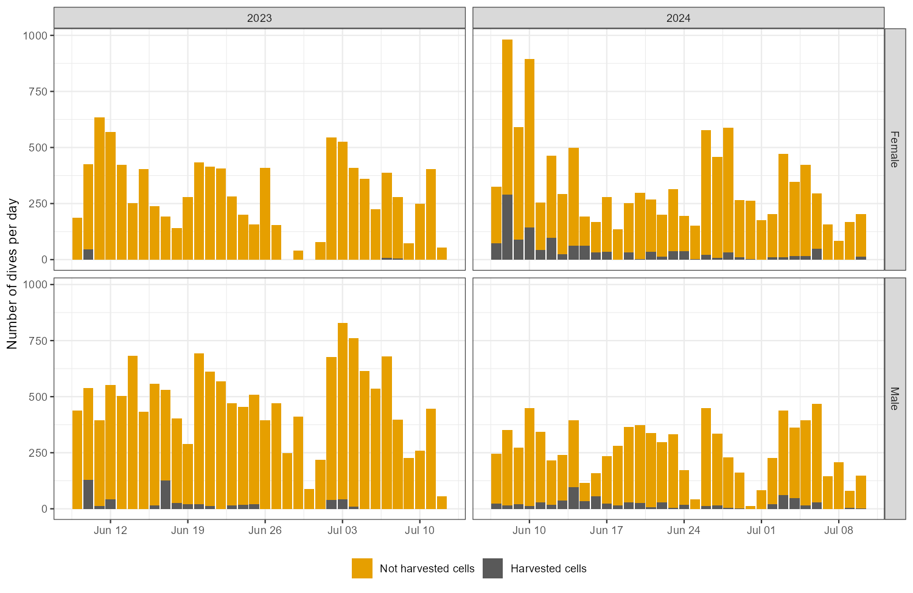

# Introduction

This document provides the detailed methods for data processing, covariate construction, statistical modelling, prediction, and validation used in the habitat-selection analyses reported in the main manuscript. We model the probability that a dive location is a “used” site (observed dives) versus an “available” site (random background) as a function of distance to colony, proximity to harvest activity, bathymetry, and other covariates. Models are fitted using flexible generalized additive models (GAMs) with individual-level random effects and a spatial smoother to account for residual spatial structure and as log-Gaussian Cox processes (LGCPs) using INLA and inlabru (three models, summarised at the end of this document).

The goals of this methods description are to:

- Describe the data sources and the cleaning/processing steps used to produce the modelling dataset;
- Define the covariates and how they were derived (including harvest timing variables);
- Present the GAM formulation used for inference and prediction, with justification of smoothing and random-effect choices;
- Explain prediction procedures and the production of maps and summary plots; and
- Describe validation and reproducibility practices.

# Study area and data sources

## Study area

Analyses were centred on a single breeding colony and restricted to locations within a $33$ km radius of the colony centroid. **Note:** this 33 km, kelp-restricted study area applies to the GAM analyses. The INLA (LGCP) models use the 35 km water region around the colony and retain dives outside kelp. All spatial calculations were performed in a projected coordinate reference system with metre units to ensure consistent buffering and distance computations.

## Primary data sources

- **Colony location**: single point used to calculate distance-to-nest (``DistNest``).

- **Kelp forest polygons** (``tareskog``): used to define available habitat for diving seabirds.

- **Dive locations**: point observations for two sampling years ($2023$ and $2024$). Each dive record includes at minimum a unique individual identifier (``ID``), a timestamp (``UTC_datetime``), sex, and logger model.

- **Harvest events**: spatial records (points or polygons) with timestamps; used to infer harvest overlap and timing relative to dive observations.

- **Environmental covariates**: GEBCO bathymetry (raster, NetCDF) and substrate shapefiles (hard rock, sediment).

All raw spatial layers were reprojected to a common metric CRS before analysis.

## Data preparation and cleaning
This section outlines the preprocessing steps applied before statistical modelling.

### Restrict observations to available habitat
Observations were retained only if they occurred within the mapped kelp polygons (tareskog) clipped to the colony-centred 33 km buffer. Restricting to mapped kelp ensures that predictions are constrained to biologically plausible habitat where diving is possible.

### Resolving duplicate intersections
Spatial intersection of point data with polygonal kelp layers occasionally created duplicate rows for a single dive when the point overlapped multiple polygon parts. To remove these duplicates while preserving observational information, we grouped by the dive identifier and a geometry identifier (derived from the geometry text), and summarised attributes by retaining the first non-missing value for each variable; a single geometry per dive was kept. This approach reduces artefactual duplication without discarding unique events.

### Temporal and spatial thinning (optional)
To reduce temporal clustering and spatial autocorrelation that can inflate Type I error rates, an optional thinning procedure was applied at the level of individual × day. Within each day for a given individual, DBSCAN clustering was performed on projected coordinates (eps set in metres, minPts = 1). From each spatial cluster the earliest timestamped observation was retained. This thinning is configurable and used to evaluate sensitivity to pseudo-replication.

###Sampling available (background) points
Available (background) points were sampled to represent habitat available to animals under plausible accessibility rules. Two strategies were used depending on analysis goals:

- Individual-specific accessible area: for each individual, we created an accessible polygon by buffering that individual’s observed points by a radius (ID_buffer_m) and intersecting the resulting buffer with the kelp mask. Background points were sampled uniformly at random from this per-individual area; sampling intensity was n_per_point background points per observed point.

- Group-level accessible area: individuals were grouped by sex and logger model. For each group, we excluded small buffers around observed locations (min_dist_m) that represent known-use zones and sampled uniformly from the remainder of the study region intersected with the kelp mask.

Harvest-aware stratification (optional): when harvest maps were available, we created a harvest buffer (e.g., 200 m) and stratified background sampling so that at least a target fraction (min_frac_in_bg, e.g., 0.25) of background points fell inside the harvest buffer. This stratification ensured sufficient representation of both harvested and unharvested strata for modelling and inference. To account for unequal sampling areas, background points sampled from different strata were assigned area-based sampling weights (area of stratum divided by number of points sampled from that stratum) and weights were normalised to have mean 1 prior to modelling.

Time-matching: timestamps for available points were randomly sampled from the set of observed timestamps for the same individual (or group) to match temporal distributions of used and available points and reduce confounding due to temporal variation in environmental or harvest conditions.

### Harvest overlap and timing covariates
For each used and available point, we computed covariates summarising harvest overlap and relative timing:

- Buffer overlap indicators: For each buffer radius r (e.g., r = 50 m and 200 m), we created a binary indicator indicating whether the point fell inside a harvest buffer of radius r.

- Earliest overlapping harvest time: Using an overlay (spatial join) between points and harvest buffers, we recorded the earliest harvest time overlapping each point (if any). When a point overlapped multiple harvest events we retained the minimum (earliest) timestamp per point.

- Temporal relation to harvest: We computed DiffTime_r = harvest_time_r − observation_time, where negative values indicate that the harvest occurred before the observation (i.e., the site was harvested prior to the dive), and positive values indicate harvest after the dive. Points were classified per radius r into categories: "after" (harvest before the observation), "before" (harvest after the observation), "same_time" (harvest time equals observation time), and "noharvest" (no overlapping harvest). From these categories we derived binary covariates used in the GAM: harvested50m = 1 if category "after" at r = 50 m, else 0 (and similarly for harvested200m).

Rationale: these covariates allow estimation of short-term (local) responses to harvest (e.g., avoidance or attraction) and examination of whether effects differ by sex or period.

## Environmental covariates and prediction grid

### Raster predictors (10 m grid)
Environmental predictors were prepared on a 10 m resolution grid covering the study extent:

Bathymetry: GEBCO netCDF rasters were reprojected to the study CRS, resampled to 10 m, and standardised (mean 0, SD 1).

Substrate: hard rock and sediment polygon layers were rasterised to binary rasters (1 = presence of substrate class, 0 = absence).

Kelp mask: tareskog polygons were rasterised to a binary mask used to constrain predictions to available habitat.

Distance rasters: for each year we computed distance-to-harvest rasters (meters) and a distance-to-colony raster (meters). Distances were standardised prior to modelling.

### Prediction grid
We generated a regular grid of prediction points (grid centres) within the kelp mask; grid spacing (e.g., 100 m for mapping or 10 m for fine-scale maps) was chosen to balance spatial resolution and computational cost. Predictions were computed at grid points and converted to raster format for visualization and for spatial aggregation.

## Data summary: dives in harvested and not harvested cells

The figure and table below summarise how many dives fall in harvested cells, using the same data as the INLA models (46,164 unique dive locations on water cells; duplicate coordinates within a bird and dives on non-water cells were removed, and no thinning for spatial autocorrelation was applied). Harvest status is taken at the exact time of each dive (within 50 m of a cut made from 1 September of the previous year up to the dive). The full day-by-day table is in the appendix of the INLA supplement and in `vignettes/inla_st70/dives_per_day_harvested.csv`.

```{r dives-totals-m}
#| label: tbl-totals-m
#| tbl-cap: "Dives per year and sex in harvested and not harvested cells (all days)."
tt <- read.csv("inla_st70/dives_totals_harvested.csv")
tt$Year <- as.character(tt$Year)
names(tt) <- c("Year", "Sex", "Days", "Birds", "Dives", "In harvested cells", "In not harvested cells", "% in harvested")
knitr::kable(tt, format.args = list(big.mark = ","))
```

{#fig-dives-m}

## INLA models of the harvest effect

The harvest results are based on three log-Gaussian Cox process (LGCP) models fitted with INLA and inlabru. Unlike the GAM, they do not use sampled background points: the available habitat enters through integration points. Full specifications, results and figures are in the INLA supplement; this section summarises the methods.

**Shared set-up.** The study region is the water area within 35 km of the colony (GEBCO elevation below 0 m, or any kelp in the cell). All dives, inside and outside kelp, are used. Covariates are read from a 50 m raster: kelp presence (any kelp in the cell), depth and depth squared, and distance to the colony. Harvest is a 1/0 covariate marking locations within 50 m of a harvest polygon, with the cut time (`GIS_TIME`) used to decide whether the cut came before the dive. This is the raster version of the point-level `harvested50m` flag described above.

**Model 1, period model.** One model per year, sex and period (before, during and after the June harvest). Harvest is the fraction of each cell within 50 m of a cut made before the start of the period. The harvest coefficient is reported with its 95% credible interval; strata with fewer than 1% of dives in harvested cells are "not estimable" (all of 2023).

**Model 2, space-time model.** All dives of 2023 and 2024 together, with the 34 dive days of 2023 and the 34 dive days of 2024 as 68 time slices (no year effect). Harvest is time-varying: 1 if the location is within 50 m of a cut made from 1 September of the previous year up to the dive time (noon for integration points), computed from a first-cut raster of all cuts from September 2022 to July 2024. The model has kelp presence, depth, depth squared, a spline for distance to colony, a sex random effect, a daily random-walk harvest effect, and a spatial field on a mesh with the dive locations as nodes and the 35 km region as boundary. Range and standard deviation of the field are fixed because an estimated field degenerated. Effort (birds with a dive per day and sex) enters through the integration weights.

**Model 3, sex-specific space-time model with a bird-level bootstrap.** As Model 2, with a separate daily harvest trend for each sex. Because the model has no individual bird effect, birds were resampled with replacement within sex and year and the model refitted for each of 100 resamples. A day is reported as preference or avoidance only if it has at least 20 dives in harvested cells from at least 3 birds, the full-data 95% interval excludes zero, and at least 60% of resamples agree in direction.

**Relevance.** The models follow the actual timing of harvest during tracking, separate habitat from harvest effects, and show when the use of harvested cells changed. In 2024 both sexes used harvested cells more than expected in early to mid June and less than expected from late June; 2023 contains almost no dives in harvested cells and cannot support a conclusion.

**Limitations.** Few days pass the exposure gate and bootstrap (the 60% agreement threshold is lenient); the spatial field is fixed; there is no individual bird effect in the model; intervals ignore uncertainty in the field, integration points and buffer size; a positive coefficient may reflect harvesters cutting where birds already forage and is not evidence of preference; season and harvest accumulate together; and repeated cuts of a cell are not distinguished.

**Future improvements.** add an individual bird effect with a cheaper integration scheme; estimate the spatial field with informative priors; add a before/after comparison for cells cut during tracking; model the number of cuts or time since the last cut; test other buffer sizes; and test the female-minus-male difference directly.
